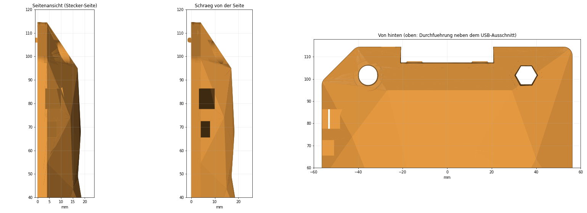
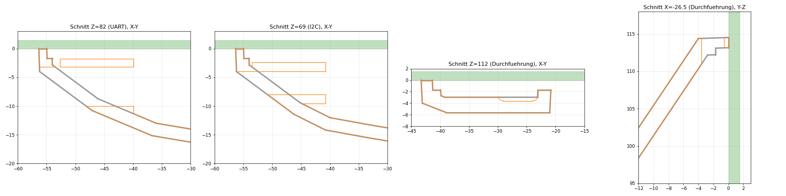

# Rückschale mit Steckern für UART und I²C

> **Stand: Entwurf, noch nicht gedruckt und nicht am Gerät anprobiert.**
> Grundlage ist die Original-Rückschale von Next Thing Co. Die Änderungen sind
> aus deren CAD- und Platinendaten berechnet, nicht am Gerät gemessen.

Ersatz für die Original-Rückschale (`NTC-100092_PocketCHIP_Back_r1.1`) mit zwei
Änderungen:

1. **Kabeldurchführung in der Oberkante**: 7 × 3 mm, mit verrundeten Kanten.
   Sie liegt neben dem Ausschnitt für den USB-Port des CHIP, von hinten gesehen
   links davon (X −30 … −23). USB-Port und Stick bleiben frei.
2. **Zwei Steckerfenster in der seitlichen Schrägfläche**, von hinten gesehen
   links, von vorn gesehen rechts, im oberen Drittel. Innen hält je eine Hülse
   den Stecker. Hinten ist sie offen für die Kabel. Die Stecker zeigen zur
   Seite und werden seitlich eingesteckt.

| Stecker | Höhe (Z) | Typ | Belegung |
|---|---|---|---|
| UART | 82 mm | JST-PH 2,0 mm, 3-polig, liegend (z. B. S3B-PH-K-S) | GND, RX, TX |
| I²C | 69 mm | JST-SH 1,0 mm, 4-polig, liegend (Qwiic/STEMMA QT, z. B. SM04B-SRSS auf Adapter) | GND, 3,3 V, SDA, SCL |




## Kabelweg

Die Kabel werden von hinten in die Leiste JP1 auf dem Platinenstreifen über
der Schale gelötet. Sie laufen flach auf der Platinenrückseite zur Seite bis zur
Durchführung und darin in die Schale. Innen gehen sie neben dem linken
CHIP-Sockel nach unten zu den Steckern. Dort hat die PocketCHIP-Platine nur das
flache Lötpad-Feld. Die Halter bleiben 1,8 mm vor der Platine.

| JP1 | Signal | an |
|---|---|---|
| 2 | `3V3_SAFE` (3,3 V, geschaltet) | I²C 3,3 V |
| 16 | `I2C-SDA` | I²C SDA |
| 17 | `I2C-SCL` | I²C SCL |
| 20 | `GND` | I²C GND |
| 18 | `UART_RX` (Eingang des PocketCHIP) | UART RX |
| 19 | `UART_TX` (Ausgang des PocketCHIP) | UART TX |
| 23 | `GND` | UART GND |

Pinnummern laut Schaltplan (`JP1` in
[NextThingCo/PocketCHIP-PCB](https://github.com/NextThingCo/PocketCHIP-PCB)).
Die Leiste ist auf der Platine beschriftet, bitte vor dem Löten abgleichen.
Dünne Litze (AWG 28–30) passt zu siebt durch die Durchführung.

- Alle Signale haben **3,3-V-Pegel**. Für 5-V-Geräte braucht es einen
  Pegelwandler, für RS-232 einen MAX3232.
- Beim Debuggen eines anderen Geräts kreuzt das Kabel: TX an RX, RX an TX,
  GND an GND.
- I²C ist am Gerät `/dev/i2c-1`. Dort sitzt schon der Tastatur-Controller auf
  0x34, alle anderen Adressen sind frei. Pull-ups sind auf der Platine.
- Der UART ist `/dev/ttyS0`, also die Systemkonsole des PocketCHIP. Er muss dafür
  freigegeben werden. SPL und U-Boot geben beim Einschalten trotzdem einige
  Sekunden Text aus. Deshalb erst den PocketCHIP starten, dann das Ziel
  anstecken.

## Drucken

- PETG oder PLA, 0,2 mm Schichthöhe, 3 Wände.
- Mit der offenen Innenseite nach oben drucken, also so, wie die Original-STL
  liegt. Die Hülsen der Stecker brauchen dann Stützen nur in den Fenstern.
- Die Fenster haben 0,3 mm Spiel. Vor dem Druck die gekauften Stecker messen
  und in `back_shell.py` eintragen (`CONNECTORS`, `GAP`).

## Anpassen und neu erzeugen

Alle Maße stehen oben in [`back_shell.py`](back_shell.py). Das Skript lädt die
Original-STEP-Datei von GitHub nach `.cache/` und ändert sie. Neu erzeugen mit
FreeCAD 1.x im Repo-Hauptordner:

```sh
/Applications/FreeCAD.app/Contents/Resources/bin/freecadcmd -c \
  "exec(open('hardware/back-shell/back_shell.py').read())"
```

## Offene Punkte

- Ob die Kabel zwischen Platine und USB-Stick oben genug Platz haben, zeigt erst
  das Gerät. Notfalls die Durchführung (`SLOT_X`) weiter nach außen schieben.
- Die Schale ist in sich facettiert. Die Fenster schneiden die Schrägfläche
  schräg an und sind außen deshalb etwas länger als der Stecker.
- Die Stecker werden in die Hülsen geklebt, z. B. mit Sekundenkleber oder
  Heißkleber. Eine Rastung ist noch nicht vorgesehen.

## Lizenz

Abgeleitet von der Rückschale aus
[NextThingCo/PocketCHIP-Mechanical](https://github.com/NextThingCo/PocketCHIP-Mechanical)
und den Platinendaten aus
[NextThingCo/PocketCHIP-PCB](https://github.com/NextThingCo/PocketCHIP-PCB),
beide [CC BY-SA 3.0 US](https://creativecommons.org/licenses/by-sa/3.0/us/).
Diese Rückschale (Skript, STEP, STL, Bilder) steht deshalb ebenfalls unter
**CC BY-SA 3.0**, nicht unter der MIT-Lizenz des übrigen Repos.
Original: Next Thing Co. Änderungen: MorastBlitz und Claude.
