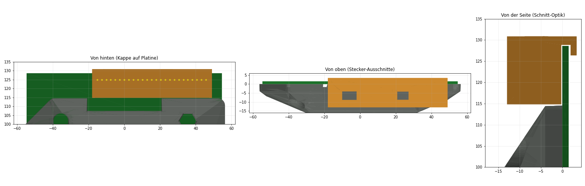

# Kappe für die GPIO-Leiste: Stecker für UART und I²C

> **Stand: Entwurf, noch nicht gedruckt und nicht am Gerät anprobiert.**
> Die Maße stammen aus den offiziellen CAD- und Platinendaten von Next Thing Co.
> und nicht aus einer Messung am Gerät. Vor dem Löten einmal drucken und
> aufstecken.



Oben am PocketCHIP schaut ein gut 14 mm breiter Platinenstreifen über die
Rückschale hinaus. Darin liegt die Kontaktleiste JP1 mit 25 Löchern im Raster
2,54 mm. Die Kappe wird von oben auf diesen Streifen gesteckt. Hinten hat sie
einen Kasten, in dem die angelöteten Kabel zu zwei Steckern laufen. Die Stecker
zeigen nach oben:

| Stecker | Typ | Belegung |
|---|---|---|
| UART | JST-PH 2,0 mm, 3-polig, stehend (z. B. B3B-PH-K-S) | GND, RX, TX |
| I²C | JST-SH 1,0 mm, 4-polig (Qwiic/STEMMA QT) auf kleiner Adapterplatine | GND, 3,3 V, SDA, SCL |

Die zwei verschiedenen Steckertypen sind Absicht: So steckt man keinen Sensor
versehentlich an den UART. Der UART-Stecker hat außerdem keine Stromleitung,
damit man einem angeschlossenen Gerät keine 3,3 V aufzwingt.

## Verdrahtung

Pinnummern laut Schaltplan (`JP1` in
[NextThingCo/PocketCHIP-PCB](https://github.com/NextThingCo/PocketCHIP-PCB)).
Die Leiste ist auf der Platine beschriftet, bitte vor dem Löten abgleichen.

| JP1 | Signal | an |
|---|---|---|
| 2 | `3V3_SAFE` (3,3 V, geschaltet) | I²C 3,3 V |
| 16 | `I2C-SDA` | I²C SDA |
| 17 | `I2C-SCL` | I²C SCL |
| 20 | `GND` | I²C GND |
| 18 | `UART_RX` (Eingang des PocketCHIP) | UART RX |
| 19 | `UART_TX` (Ausgang des PocketCHIP) | UART TX |
| 23 | `GND` | UART GND |

- Alle Signale haben **3,3-V-Pegel**. Für 5-V-Geräte braucht es einen
  Pegelwandler, für RS-232 einen MAX3232.
- Zum Debuggen eines anderen Geräts kreuzt das Kabel: TX des PocketCHIP an RX
  des Ziels und umgekehrt, GND an GND.
- I²C liegt am Gerät auf `/dev/i2c-1`. Dort sitzt schon der Tastatur-Controller
  auf Adresse 0x34, alle anderen Adressen sind frei. Pull-up-Widerstände sind
  auf der PocketCHIP-Platine.
- Der UART ist `/dev/ttyS0`, also die Systemkonsole des PocketCHIP. Damit er für
  andere Geräte frei ist, muss die Konsole dort abgeschaltet werden. SPL und
  U-Boot geben beim Einschalten trotzdem einige Sekunden Text aus. Deshalb erst
  den PocketCHIP starten, dann das Ziel anstecken.

Die Kabel von hinten durch die Löcher stecken und vorn verlöten, dann vorn
bündig abschneiden. Die Kappe greift vorn nur 2 mm über die Platinenkante und
bleibt oberhalb der Lötstellen.

## Drucken

- Material: PETG oder PLA, 0,2 mm Schichthöhe, 3 Wände.
- Mit der **offenen Unterseite auf das Druckbett** legen, also kopfüber. Dann
  braucht es keine Stützen; nur der Deckel überbrückt ~13 mm.
- Die Ausschnitte für die Stecker haben 0,25 mm Spiel. Je nach Drucker in
  `header_cap.py` anpassen (`UART_CUT`, `I2C_CUT`, `GAP`).

## Anpassen und neu erzeugen

Alle Maße stehen oben in [`header_cap.py`](header_cap.py). Neu erzeugen mit
FreeCAD 1.x:

```sh
/Applications/FreeCAD.app/Contents/Resources/bin/freecadcmd -c \
  "exec(open('hardware/header-cap/header_cap.py').read())"
```

Das Skript arbeitet im Koordinatensystem der NTC-Rückschale
(`NTC-100092_PocketCHIP_Back_r1.1`). So kann man die Kappe in FreeCAD zusammen
mit der Original-STEP-Datei öffnen und die Passung prüfen.

## Offene Punkte

- Ob die Kappe allein durch den Schlitz hält, zeigt erst der Probedruck.
  Sonst einen Tropfen Heißkleber in den Kasten oder eine Rastnase an der
  Lippe ergänzen.
- Der Kasten ist 13 mm tief und steht damit hinten etwa 8 mm über die
  Rückschale hinaus, die oben nur ~4,6 mm tief ist. Flacher geht es mit
  liegenden Steckern, die nach hinten zeigen.
- Die Tasche für die Qwiic-Adapterplatine (12 × 10,5 mm) passt zu kleinen
  JST-SH-Adaptern, die genauen Maße hängen vom gekauften Teil ab.

## Lizenz

Abgeleitet aus den CAD- und Platinendaten von Next Thing Co.
([PocketCHIP-Mechanical](https://github.com/NextThingCo/PocketCHIP-Mechanical),
[PocketCHIP-PCB](https://github.com/NextThingCo/PocketCHIP-PCB)), die unter
[CC BY-SA 3.0 US](https://creativecommons.org/licenses/by-sa/3.0/us/) stehen.
Diese Kappe (Skript, STEP, STL, Vorschau) steht deshalb ebenfalls unter
**CC BY-SA 3.0**, nicht unter der MIT-Lizenz des übrigen Repos.
